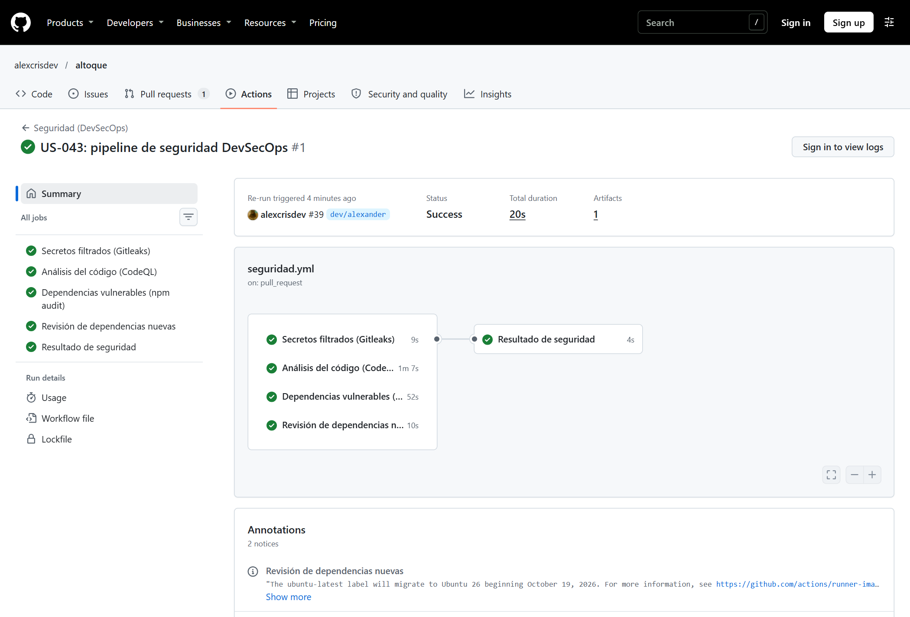
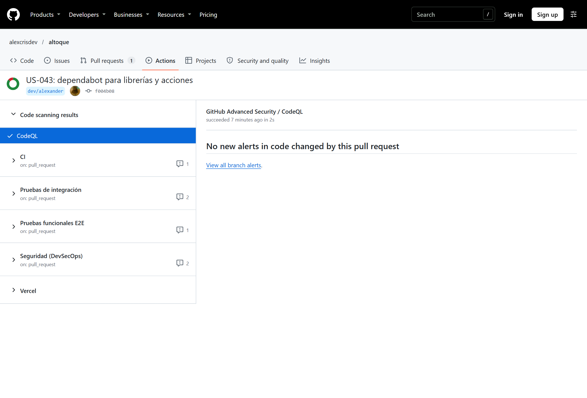
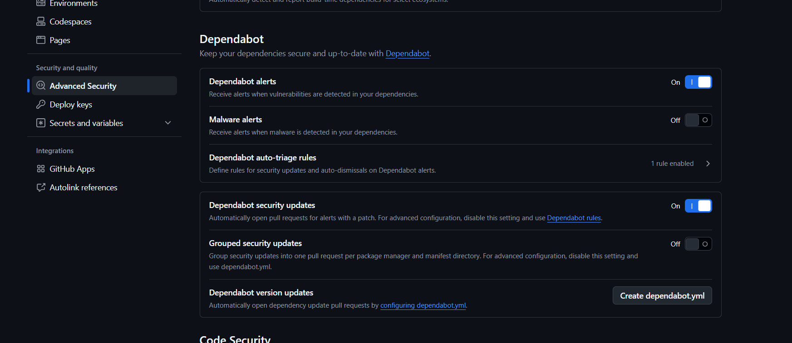
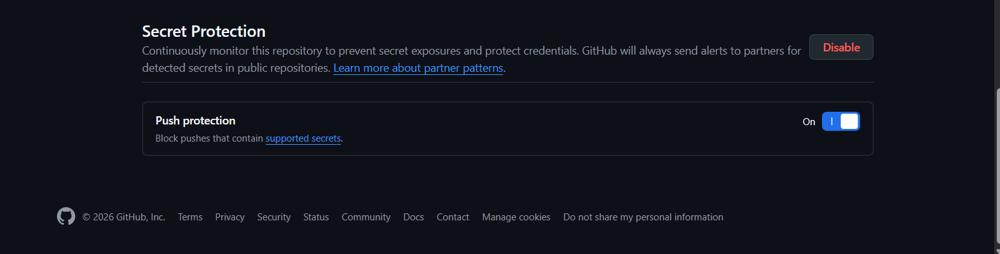

# US-043: pipeline de seguridad (DevSecOps)

Alexander · 03/11/2026 · PR #39, commit `f004b08`.

## Qué revisa el pipeline

`.github/workflows/seguridad.yml` corre en cada PR y push a `develop`/`main`, los lunes a las 8:00 (hora de Lima) y a mano.

| Job | Herramienta | Qué detecta | Cuándo bloquea |
|---|---|---|---|
| Secretos filtrados | Gitleaks | Claves, tokens o contraseñas subidas en commits | Si encuentra cualquier secreto |
| Análisis del código | CodeQL (`security-extended`) | Inyecciones, XSS y otros patrones inseguros en TypeScript | Las alertas nuevas aparecen como check "CodeQL" en el PR |
| Dependencias vulnerables | npm audit | Librerías con vulnerabilidades conocidas | Solo si es alta/crítica y llega a producción (`--omit=dev`) |
| Revisión de dependencias nuevas | Dependency Review | Librerías vulnerables que agrega un PR | Severidad alta o mayor; solo corre en PR |
| Resultado de seguridad | — | Junta los cuatro resultados | Si alguno falló (`skipped` cuenta como válido) |

Además, `.github/dependabot.yml` abre cada lunes PRs agrupados hacia `develop` con actualizaciones de npm y de las acciones de GitHub.

## Evidencias

**Gráfico del pipeline.** Las cuatro revisiones corren en paralelo y el job final depende de todas (`needs`). Todo en verde.

**CodeQL en el PR.** Sin alertas nuevas en el código del PR. En el repositorio quedan 0 alertas abiertas.

**Dependabot en el repositorio.** Alertas y security updates activados. El botón "Create dependabot.yml" desaparece cuando el archivo de este PR llega a `develop`, la rama por defecto.

**Protección de secretos.** Secret scanning y push protection activados: GitHub rechaza un push que traiga una clave reconocible.

El detalle de cada ejecución, con tiempos y la revisión previa local, está en [us043-validacion.txt](us043-validacion.txt).

## Lo que encontró el pipeline

La primera ejecución falló en "Revisión de dependencias nuevas" porque el repositorio no tenía activado el *Dependency graph*. Se activó desde Settings, se volvieron a correr los jobs fallidos y pasaron. Es un ejemplo de lo que busca DevSecOps: el problema era de configuración y lo detectó el pipeline, no una persona.

## Límites conocidos

- npm audit reporta 16 vulnerabilidades moderadas en herramientas de desarrollo (cadena de ESLint). No llegan a producción, por eso no bloquean; Dependabot propondrá la actualización.
- Los PRs de Dependabot no reciben los secretos de Supabase, así que en esos PRs fallarán integración y E2E. Es esperado y no son checks obligatorios.
- Todos los entornos usan la misma base de Supabase; este pipeline no la toca.
