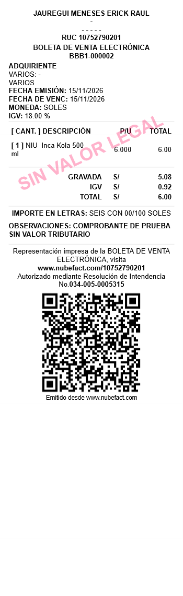
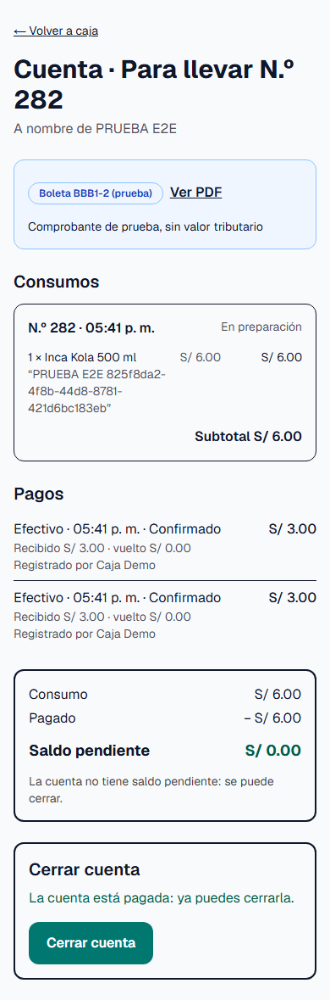
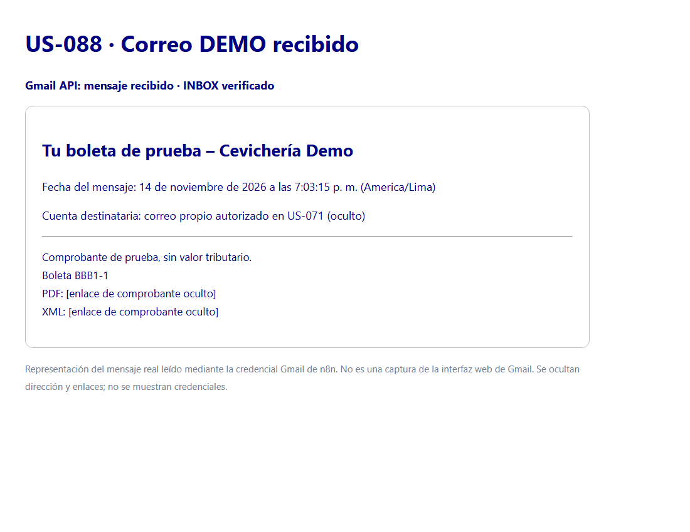
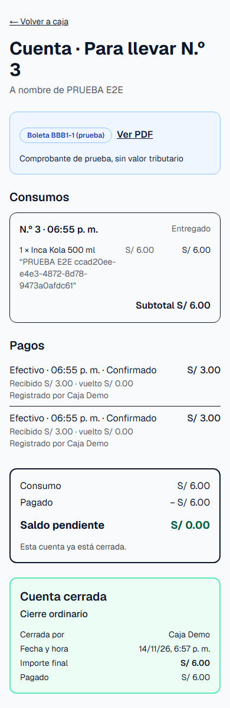

# US-088 — Validación técnica y pendientes de aceptación

Fecha: **14/11/2026**, America/Lima. Rama de trabajo: `dev/erick`.

## Reserva solo con correo — 16/11/2026

**Regla:** la boleta de prueba se reserva solo si la cuenta tiene correo para
la boleta en al menos un pago `CONFIRMED`, del mismo restaurante y de la misma
`table_session_id` o `order_id`. Se ignoran correos nulos, vacíos o con espacios.
Sin correo, el pago se registra normalmente y no consume un número de boleta.
Un pago parcial con correo no reserva todavía; el pago final sin correo sí
puede reservar porque la cuenta ya tiene un correo confirmado.

Migración nueva: `20261116220801_us088_boleta_solo_con_correo.sql`.
Se comparó con la definición de `20261115221935_us088_boletas_prueba.sql`:
solo añade la condición `if not exists` antes de leer la serie y usa
`create or replace`. Conserva `security definer`, `set search_path = ''`,
el `revoke`, los bloqueos y las validaciones anteriores. No redefine el trigger
ni otras funciones. La migración ya aplicada no se editó.

Pruebas realizadas en Supabase **LOCAL**, reconstruido con
`npx supabase db reset --local` y todas las migraciones, incluida la nueva:

- Usuarios demo preparados con `node --env-file=.env.local scripts/usuarios-demo.mjs`,
  con URL y claves locales establecidas en el proceso antes de cargar el archivo.
  Se comprobó loopback y el puerto local; esas variables prevalecen sobre el
  archivo. `.env.local` se conservó intacto y no se ejecutaron pruebas remotas.
- `tests/rls/boletas-local.test.ts`: **11/11**, incluido el SQL previo de
  snapshot, RLS e idempotencia y diez regresiones de reserva: cinco por modalidad
  (mesa y para llevar). Sin correo null/vacío/espacios no hay reserva ni avance;
  con correo se reserva el siguiente número; parcial con correo + final sin
  correo reserva únicamente al completar el saldo. Cada caso usa ROLLBACK.
- Integración completa: **136/136 en dos vueltas consecutivas**, 17 archivos.
  Se ejecutó `node --env-file=.env.local node_modules/vitest/vitest.mjs run tests/rls --no-file-parallelism`
  con el destino local fijado en el proceso, nunca con el destino compartido.
- `npm test`: **1320/1320**, 80 archivos.
- `npm run lint` y `npm run typecheck`: aprobados.
- Build de producción con variables locales: aprobado. El primer intento no
  completó la compilación; el segundo compiló correctamente.
- `npm run build` con la configuración habitual: aprobado al repetirlo.
  Next.js 16.4.3 mostró una advertencia de vulnerabilidad conocida; la primera
  ejecución terminó con `SecurityFatalError` después de compilar y la repetición
  terminó con código 0 conservando la advertencia. No se actualizaron dependencias
  en este ajuste; el aviso requiere seguimiento separado por el equipo.
- `tests/e2e/boleta.spec.ts`: **1/1 aprobado**, con correo, reserva, rechazo del
  callback sin firma, callback firmado repetido y PDF simulado visible en caja.
  Se reutilizó el archivo sin modificarlo. El primer recorrido se detuvo porque
  la configuración temporal usaba el mismo token para mesa y para llevar; se
  corrigió esa configuración y se repitió satisfactoriamente.

Los casos nuevos usan un local de prueba propio, Mesa 88 y QR de transacción.
La prueba SQL heredada usa un QR para llevar propio en otro local temporal.
No se usó Mesa 5 ni se regeneraron los QR del equipo. La suite completa se
ejecutó sobre copias del seed exclusivamente locales.
La E2E usó un QR propio para llevar en un local de prueba separado, servidor
aislado en puerto 3118 y HMAC efímero; no usó el mostrador del equipo.

No se aplicó la migración a la base compartida, no se borraron ni modificaron
BBB1-3 a BBB1-32 y no se cambió el correlativo compartido. No se contactó a
Nubefact ni Gmail: los números de las aserciones son fixtures de la base local.

Límite de alcance: la reserva considera correos de pagos confirmados anteriores,
pero el aviso n8n sigue leyendo el correo del pago actual. Este ajuste no agrega
recuperación del correo anterior al aviso ni reenvío de avisos históricos.

Pendiente de Alexander: revisar la migración en su entorno local, aplicarla y
configurar `receipt_series` con el siguiente número acordado (33) antes de
una única prueba DEMO que incluya correo en el pago final.

---

## Revisión sobre US-097 — 15/11/2026

La migración vigente para aplicar es
`supabase/migrations/20261115221935_us088_boletas_prueba.sql`, posterior a
las migraciones de Alina. Se retiró el archivo anterior de US-088, que todavía
no había sido aplicado en la base compartida. No aplicar ambos archivos.

### Decisiones del merge

El único archivo con conflicto explícito fue
`src/features/pago-cierre/pago-online-actions.ts`:

- Importaciones: se conservan iniciar/vincular/cancelar Checkout de Alina y
  la validación de correo de US-088.
- Preparación: se conserva el registro y snapshot de Checkout, el monto de
  la base, su expiración, clave de idempotencia y tratamiento de fallos.
  A la metadata de sesión que incluye `checkout_id` se añade únicamente el
  correo voluntario. El PaymentIntent mantiene metadata sin ese correo.

Se revisaron las fusiones automáticas de `pago-online.ts`, `stripe-logica.ts`,
`webhook-stripe.ts` y sus pruebas. Se preserva el reconocimiento de Checkout,
los pagos tardíos y el flujo de reembolsos de Alina. El correo solo se lee de
la metadata de la sesión y llega como `p_receipt_email`; el correo solicitado
por Stripe se ignora.

### Preservación SQL y regresión

La función Stripe nueva se copió de `20261115190000` y se comprobó textualmente
que, retirando únicamente el parámetro y el guardado del correo, se recuperan
exactamente la definición y los permisos de Alina. Se mantienen OPEN, snapshot,
expiración, monto, CHECKOUT_STALE, consulta de duplicados bajo bloqueo y PAID.
Se elimina la firma de cinco argumentos y se declara la nueva de seis, con
correo predeterminado null y ejecución exclusiva de service_role.

Se comprobó que `registrar_pago` sigue partiendo de su definición más reciente
de `20261102120000`. No se modificaron las migraciones de Alina ni
`iniciar_checkout_stripe` de `20261115210000`. La prueba SQL verifica que el
trigger `payments_us094_iniciar_preparacion_sesion` sigue liberando pedidos.

Resultados de esta revisión:

- Base local recreada desde cero con `supabase db reset --local`; se aplicaron
  US-094, todas las migraciones US-097 y finalmente US-088.
- Usuarios demo preparados con variables de Supabase local, sin editar `.env.local`.
- Unitarias: **1111/1111 aprobadas**, incluidas las nuevas combinaciones de
  correo + Checkout y correo + reembolso de un Checkout obsoleto.
- Integración: **109/109 aprobadas en dos vueltas consecutivas**, 15 archivos,
  incluyendo `vencimiento-pedidos.test.ts` y `boletas-local.test.ts`.
- La prueba SQL de US-088 es transaccional y termina con ROLLBACK: valida
  correo normalizado, snapshot obligatorio, PAID, correlativos, RLS y callback.
- `npx eslint src tests scripts`, typecheck y build aprobados.

Se encontró un fallo intermitente en IDs ficticios de PaymentIntent que podían
contener 13 dígitos seguidos y activar `payments_reference_sin_tarjeta`.
Se mantuvo esa protección SQL; solo se sustituyeron los separadores del UUID
ficticio por letras en las pruebas RLS de espera de pago y vencimiento.

### Repetición DEMO con el código integrado

El usuario reconfirmó DEMO y autorizó un único envío a su correo propio de
US-071. Primero se consultó BBB1-2 en Nubefact: HTTP 400, código 24, libre.
Después, con Supabase local y la migración nueva, se confirmó un pedido de
S/ 6.00 en dos pagos de S/ 3.00. El primero no creó reserva; el segundo reservó
BBB1-2. n8n emitió la boleta DEMO real, devolvió PDF/XML y el callback dejó
la misma reserva EMITIDO. Gmail envió el correo y confirmó el mismo mensaje
en INBOX. La cuenta se entregó y cerró mediante la interfaz.

La prueba funcional propia pasó **1/1** sobre el código de US-094/US-097 y US-088
integrados. Se utilizó un receptor HTTP local para capturar el aviso firmado y
una copia inactiva ejecutada por CLI; se adaptaron solo los nodos de entrada y
respuesta para ese modo. Nubefact, Gmail y el callback a AlToque fueron reales.
Los flujos publicados no se modificaron. Las contraseñas de los seis usuarios
locales se restauraron al finalizar y no se escribieron claves en archivos públicos.

**Última boleta DEMO emitida: BBB1-2.** Alexander debe confirmar el siguiente
correlativo libre antes de cargar `receipt_series` en la base compartida.
Tras la emisión se consultó BBB1-3: Nubefact devolvió HTTP 400 y código 24,
confirmando que estaba libre. No se emitió BBB1-3 ni se envió otro correo.

La evidencia del correo representa el mensaje real obtenido por API, no la
interfaz web de Gmail. Se ocultan dirección y enlaces.

No se ha escrito en la base compartida, aplicado migraciones remotas, hecho
push ni reabierto el PR #83 durante esta revisión.

---

## Evidencia anterior — 14/11/2026

**Estado: implementación y prueba DEMO real aprobadas en entorno local;
revisión de la migración y despliegue compartido pendientes.**
Comprobante de prueba, sin valor tributario.

## Alcance y ajustes de Alexander

- AlToque reserva `PENDIENTE`, serie y número al completar el pago. La función
  del trigger bloquea `receipt_series`; n8n no asigna correlativos.
- Una reserva por sesión/pedido y por pago, con unicidad de restaurante/serie/número.
  El callback solo actualiza esa reserva. Repetirlo no crea otra fila.
- `receipt_series` no se carga automáticamente. Alexander comprueba el siguiente
  número libre de BBB1 en Nubefact y configura el restaurante al aplicar la migración.
- Se eliminan las firmas viejas de `registrar_pago` y `registrar_pago_stripe`;
  las nuevas llevan `p_receipt_email text default null`, con permisos explícitos.
  Las llamadas anteriores sin correo siguen admitidas por el valor predeterminado.
- El correo voluntario de Stripe viaja en metadata de la sesión, no se toma del
  correo solicitado por Stripe ni se copia al PaymentIntent. Si alguien altera
  esa metadata con un correo inválido, se conserva el registro del pago y se
  omite el correo.
- URL privada de Nubefact en variable privada del despliegue y proxy interno,
  alternativa acordada para conservar bloqueado el acceso de Code al entorno.
  Token exclusivamente en Header Auth de n8n. Plantilla sin credenciales.

## Resultados ejecutados

| Comprobación | Resultado |
|---|---|
| `npm run lint` | Aprobado |
| `npm run typecheck` | Aprobado |
| `npm test` | 969/969 aprobadas; 24 casos en `comprobantes.test.ts` |
| `npm run build` | Aprobado, incluida `/api/n8n/comprobantes` |
| Migraciones desde cero | Aplicadas en Supabase local, incluida la migración nueva |
| `supabase/tests/us088_boletas.sql` | Aprobado en `supabase_db_altoque`; rollback de todos los datos de cada ejecución |
| Regresión Playwright | 20/20 aprobadas, Chromium, instancia aislada `localhost:3100` con Supabase local |
| Comprobación E2E ampliada US-088 | 1/1 aprobada: añade correo inválido del cliente con Stripe simulado y captura de caja a 390 px |
| Emisión Nubefact DEMO real | BBB1-1 emitida; PDF y XML descargados y comprobados |
| Gmail real | Mensaje enviado y leído mediante Gmail OAuth; etiqueta INBOX confirmada |
| Caja con comprobante real | Boleta BBB1-1 visible con PDF y aviso sin valor tributario; captura a 390 px |
| `docker compose --profile boletas config --quiet` | Configuración válida; no se reinició el n8n existente |
| Revisión de Git autorizada | `dev/erick`, sin errores de espacios; implementación guardada en `ffeff94` y [PR #83](https://github.com/alexcrisdev/altoque/pull/83) hacia develop |

La primera ejecución de build encontró un `runtime` explícito incompatible con
Cache Components y una descarga de fuentes bloqueada por la red restringida.
Se retiró esa opción de la ruta (Node.js es el runtime de Cache Components) y
el build se repitió correctamente con acceso de red. No se modificó el diseño
ni la configuración de fuentes.

## Qué se verificó

### Unitarias, sin red

- Aviso v2 con saldo pendiente, reserva estable y correo exclusivamente opcional.
- Correo vacío/espacios, normalización, longitud máxima y formatos inválidos.
- HMAC del cuerpo exacto: válido, alterado, vencido, futuro, secreto incorrecto
  y firma mal formada. El resultado sin firma no accede a la base.
- JSON inválido firmado, tamaño máximo y enlaces inseguros rechazados.
- Callback llama a actualizar una reserva; un conflicto devuelve 409 sin crear
  series ni números nuevos. La persistencia idempotente se prueba en SQL real.
- Metadata de Checkout y lectura del webhook: el correo de Stripe se ignora.
- Tipo 2, VARIOS, reserva de serie/número, separación base/IGV, totales,
  fecha actual de Lima y restricción de importe menor de S/ 700.
- Pagos parciales, avisos v1, reservas ausentes o emitidas no pasan a emisión.
- Preparación y lectura del proveedor ejecutadas también con el código exacto
  exportado en el JSON de n8n, dentro de un sandbox sin acceso a red.

### SQL/RLS reales, exclusivamente locales

- Efectivo parcial sin reserva; Yape pendiente sin reserva; verificar Yape
  hasta saldo cero reserva BBB1-7 y avanza una sola vez el siguiente número.
- Correo inválido rechazado por CHECK; correo válido persistido.
- Llamada compatible sin correo y reintento idempotente del pago original.
- Firmas SQL antiguas ausentes, sin sobrecargas ambiguas.
- Caja ve su boleta; otro restaurante, visitante, cocina y mesero no la leen.
  Usuario autenticado no puede insertar ni ejecutar la actualización del callback.
- Servicio actualiza ERROR → EMITIDO; repetir EMITIDO devuelve la misma fila.
  Otro número o enlaces distintos de una boleta emitida se rechazan.
- Stripe reserva otra boleta con el siguiente número; un evento repetido
  conserva el mismo pago y no consume otro correlativo.

### Navegador, con proveedor simulado

La suite completa utilizó usuarios ficticios creados en Supabase local, con
contraseña efímera. La Mesa 5 y sus QR se prepararon **solo en esa instancia**;
no se regeneraron los códigos de la base compartida. Los avisos externos
estuvieron desactivados.

La E2E de US-088 confirmó un pedido local, completó el pago en caja, comprobó
la reserva PENDIENTE, rechazó un callback sin firma y aceptó dos callbacks
firmados idénticos. Confirmó una única boleta, enlace PDF, aviso sin valor
tributario y ausencia de desborde horizontal a 390 px. Después entregó y cerró
la cuenta mediante las pantallas existentes.

La comprobación ampliada habilitó el botón del cliente con una clave ficticia
de Stripe y escribió un correo inválido: el servidor lo rechazó antes de abrir
Checkout. No se contactó a Stripe ni se cobró dinero.

**Esta captura usa enlaces `example.test`: no acredita una emisión real de
Nubefact ni un correo recibido.**

## Validación DEMO real — 14/11/2026

Se utilizó exclusivamente Supabase local y la empresa Nubefact DEMO confirmada
por el usuario. Se cargó BBB1 con el siguiente número libre comunicado: **1**.
El pedido ficticio tuvo un consumo de **S/ 6.00**, pagado en dos partes de
S/ 3.00. El primer pago no creó reserva; el segundo dejó saldo cero y reservó
una única fila PENDIENTE para BBB1-1.

El primer intento de ejecutar el flujo por consola falló y dejó la reserva
pendiente. Se adaptaron únicamente los nodos de respuesta HTTP de la copia
privada de prueba y se reenvió el aviso del **mismo pago**, con firma nueva,
sin registrar otro pago ni consumir otro número. La emisión se completó
aproximadamente a las **19:03, America/Lima**.

### Recorrido y límites de esta comprobación

- La interfaz real de caja registró los dos pagos locales. El reenvío posterior
  utilizó `enviarAvisoPago` y la reserva existente; no se construyó una boleta
  ficticia como respuesta del proveedor.
- El aviso firmado llegó a un receptor HTTP local de prueba, que lo entregó
  a una copia inactiva del flujo n8n ejecutada por CLI. Se conservaron la
  verificación HMAC, preparación, consulta/emisión HTTP, callback y Gmail.
  En esa copia, el nodo de entrada leyó el aviso capturado y los nodos
  Respond to Webhook se sustituyeron por NoOp, porque CLI no tiene una
  conexión HTTP de webhook a la que responder.
- Nubefact y Gmail fueron servicios **reales**, con sus credenciales almacenadas
  en n8n. El PDF contiene la marca **SIN VALOR LEGAL** y la observación de
  comprobante de prueba sin valor tributario. Se descargaron PDF y XML.
- El callback firmado actualizó la misma reserva a EMITIDO. La cuenta local
  quedó entregada, pagada y cerrada; caja muestra la boleta aun estando cerrada.
- Gmail devolvió el mensaje enviado y después se leyó ese mismo mensaje con
  su etiqueta **INBOX**, confirmando recepción en la cuenta propia autorizada
  de US-071. No se envió a terceros.
- No se publicaron ni cambiaron los flujos activos de US-071/US-086. La copia
  local de validación quedó inactiva y sin el secreto efímero ni el aviso capturado.
  La entrega al webhook publicado en un despliegue compartido sigue siendo
  una comprobación de despliegue posterior; no se presenta como ejecutada aquí.

Después se consultó **BBB1-2** directamente desde n8n, usando únicamente
`consultar_comprobante`: Nubefact respondió **HTTP 400, código 24** (documento
inexistente). Por tanto, al cierre de esta validación, el siguiente número
libre verificado era **2**. Esa consulta no emitió otra boleta ni envió correo.

### Evidencias reales

Primera página del PDF descargado directamente de Nubefact DEMO, renderizada
con el lector PDF de Windows; no es una boleta fabricada ni una simulación:

Mensaje real leído desde Gmail API mediante n8n. La captura representa su
contenido y la recepción INBOX; **no es una captura de la interfaz web de Gmail**.
Se ocultan la dirección del destinatario y los enlaces del comprobante:

Caja a 390 px, con la reserva real en EMITIDO, el PDF del proveedor y los dos pagos:

## Criterios de aceptación

| Criterio | Estado y evidencia |
|---|---|
| 1. n8n → Nubefact DEMO → PDF/XML | Aprobado: emisión real BBB1-1 mediante la copia CLI local; PDF/XML descargados. Webhook publicado pendiente de comprobar al desplegar |
| 2. Correo opcional y envío Gmail | Aprobado: envío real y lectura del mismo mensaje con etiqueta INBOX |
| 3. Guardar serie/número/enlaces | Aprobado: callback real guardó EMITIDO en la misma reserva local; idempotencia adicional en SQL y E2E |
| 4. Boleta visible en caja | Aprobado: captura de caja con PDF real, además de las pruebas simuladas anteriores |
| 5. Aviso sin valor tributario | Aprobado en pantalla, flujo y guía |
| 6. Credencial fuera del repositorio | Aprobado: Header Auth y Gmail existentes utilizados solo por n8n; plantilla pública vacía, sin token ni ruta privada |
| 7. DEMO y rotación antes de emitir | Confirmados por el usuario antes de la emisión; PDF real con marca SIN VALOR LEGAL. La captura del panel se comparte con Alexander por privado |

## Pendientes de revisión y despliegue

1. Alexander revisa y aplica la migración en la base compartida. Confirma el
   correlativo libre de BBB1 y carga `receipt_series`: BBB1-1 ya está utilizado
   por la prueba DEMO; no volver a configurarlo como 1. En esta sesión
   **no se escribió en Supabase compartido**.
2. El UUID privado del endpoint se configuró en `infra/n8n/.env` y se inició
   únicamente el proxy adicional. `.env.local` quedó intacto: el secreto HMAC,
   las claves de Supabase local y las variables de la prueba se pasaron solo
   a los procesos aislados. Para el uso compartido, publicar el flujo original
   con las credenciales, secreto y callback definitivos y probar su webhook HTTP.
3. Erick comparte por privado con Alexander el correlativo que esté libre al
   aplicar la migración y la captura del panel DEMO. No compartir tokens.
4. Una emisión DEMO real sin correo y el reenvío real de un aviso ya EMITIDO
   no se ejecutaron para evitar consumir otro número o reenviar correo.
   Estas ramas están cubiertas por pruebas unitarias, SQL y E2E locales.

La validación real emitió una sola boleta y envió un solo correo.
No hay cola de entrega automática; la limitación de reintentos y el posible
reenvío de correo al reejecutar manualmente un evento antiguo están descritos
en [la guía](../../automatizacion/boleta.md).

## Archivos del avance

- Migración: `supabase/migrations/20261115221935_us088_boletas_prueba.sql`;
  prueba SQL: `supabase/tests/us088_boletas.sql`.
- Callback: `src/app/api/n8n/comprobantes/route.ts`,
  `src/features/pago-cierre/comprobante-actions.ts`, `comprobantes.ts`,
  `comprobante-logica.ts`.
- Aviso v2: `aviso-n8n.ts`, `aviso-n8n-logica.ts` en la misma funcionalidad.
- Correo y cobro: `correo-boleta.tsx`, `cobrar-cuenta.tsx`,
  `registrar-pago-efectivo.tsx`, `registrar-pago-yape.tsx`,
  `registrar-pago-tarjeta.tsx`, `actions.ts`, `pagos.ts`.
- Stripe: `boton-pagar-tarjeta.tsx`, `pago-online-actions.ts`,
  `pago-online.ts`, `stripe-logica.ts`.
- Lectura y pantalla de caja: `cuentas.ts`, `detalle-cuenta.tsx`.
- n8n: `infra/n8n/flujos/boleta-nubefact.json`, `boleta-logica.mjs`,
  `infra/n8n/nubefact.conf.template`, `docker-compose.yml`, `.env.example`,
  generador `scripts/generar-boleta.mjs`.
- Unitarias: `tests/unit/comprobantes.test.ts`, `aviso-n8n.test.ts`,
  `pago-online-actions.test.ts`, `pagos-caja.test.ts`.
- E2E: `tests/e2e/boleta.spec.ts`.
- Documentación: `docs/automatizacion/boleta.md`, `aviso-pago.md`,
  únicamente la fila US-088 añadida a `docs/pruebas/matriz-trazabilidad.md`,
  este informe y la captura local simulada.
  El avance de validación real agrega las tres capturas `us088-*-demo-*.png`
  y actualiza únicamente esta historia en la matriz.
