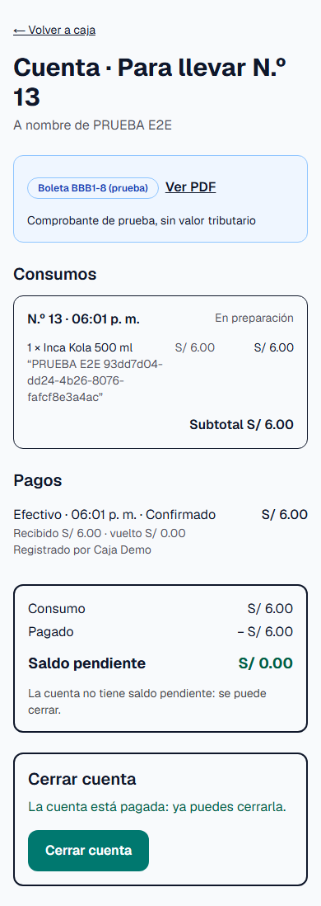

# US-088 — Validación técnica y pendientes de aceptación

Fecha: **14/11/2026**, America/Lima. Rama de trabajo: `dev/erick`.

**Estado: implementación probada localmente; aceptación externa pendiente.**
Comprobante de prueba, sin valor tributario.

## Alcance y ajustes de Alexander

- AlToque reserva `PENDIENTE`, serie y número al completar el pago. La función
  del trigger bloquea `receipt_series`; n8n no asigna correlativos.
- Una reserva por sesión/pedido y por pago, con unicidad de restaurante/serie/número.
  El callback solo actualiza esa reserva. Repetirlo no crea otra fila.
- `receipt_series` no se carga automáticamente. Alexander comprueba el siguiente
  número libre de BBB1 en Nubefact y configura el restaurante al aplicar la migración.
- Se eliminan las firmas viejas de `registrar_pago` y `registrar_pago_stripe`;
  las nuevas llevan `p_receipt_email text default null`, con permisos explícitos.
  Las llamadas anteriores sin correo siguen admitidas por el valor predeterminado.
- El correo voluntario de Stripe viaja en metadata de la sesión, no se toma del
  correo solicitado por Stripe ni se copia al PaymentIntent. Si alguien altera
  esa metadata con un correo inválido, se conserva el registro del pago y se
  omite el correo.
- URL privada de Nubefact en variable privada del despliegue y proxy interno,
  alternativa acordada para conservar bloqueado el acceso de Code al entorno.
  Token exclusivamente en Header Auth de n8n. Plantilla sin credenciales.

## Resultados ejecutados

| Comprobación | Resultado |
|---|---|
| `npm run lint` | Aprobado |
| `npm run typecheck` | Aprobado |
| `npm test` | 969/969 aprobadas; 24 casos en `comprobantes.test.ts` |
| `npm run build` | Aprobado, incluida `/api/n8n/comprobantes` |
| Migraciones desde cero | Aplicadas en Supabase local, incluida la migración nueva |
| `supabase/tests/us088_boletas.sql` | Aprobado en `supabase_db_altoque`; rollback de todos los datos de cada ejecución |
| Regresión Playwright | 20/20 aprobadas, Chromium, instancia aislada `localhost:3100` con Supabase local |
| Comprobación E2E ampliada US-088 | 1/1 aprobada: añade correo inválido del cliente con Stripe simulado y captura de caja a 390 px |
| `docker compose --profile boletas config --quiet` | Configuración válida; no se reinició el n8n existente |
| Revisión de Git autorizada | `dev/erick`, sin errores de espacios; sin commit/push/PR de US-088 |

La primera ejecución de build encontró un `runtime` explícito incompatible con
Cache Components y una descarga de fuentes bloqueada por la red restringida.
Se retiró esa opción de la ruta (Node.js es el runtime de Cache Components) y
el build se repitió correctamente con acceso de red. No se modificó el diseño
ni la configuración de fuentes.

## Qué se verificó

### Unitarias, sin red

- Aviso v2 con saldo pendiente, reserva estable y correo exclusivamente opcional.
- Correo vacío/espacios, normalización, longitud máxima y formatos inválidos.
- HMAC del cuerpo exacto: válido, alterado, vencido, futuro, secreto incorrecto
  y firma mal formada. El resultado sin firma no accede a la base.
- JSON inválido firmado, tamaño máximo y enlaces inseguros rechazados.
- Callback llama a actualizar una reserva; un conflicto devuelve 409 sin crear
  series ni números nuevos. La persistencia idempotente se prueba en SQL real.
- Metadata de Checkout y lectura del webhook: el correo de Stripe se ignora.
- Tipo 2, VARIOS, reserva de serie/número, separación base/IGV, totales,
  fecha actual de Lima y restricción de importe menor de S/ 700.
- Pagos parciales, avisos v1, reservas ausentes o emitidas no pasan a emisión.
- Preparación y lectura del proveedor ejecutadas también con el código exacto
  exportado en el JSON de n8n, dentro de un sandbox sin acceso a red.

### SQL/RLS reales, exclusivamente locales

- Efectivo parcial sin reserva; Yape pendiente sin reserva; verificar Yape
  hasta saldo cero reserva BBB1-7 y avanza una sola vez el siguiente número.
- Correo inválido rechazado por CHECK; correo válido persistido.
- Llamada compatible sin correo y reintento idempotente del pago original.
- Firmas SQL antiguas ausentes, sin sobrecargas ambiguas.
- Caja ve su boleta; otro restaurante, visitante, cocina y mesero no la leen.
  Usuario autenticado no puede insertar ni ejecutar la actualización del callback.
- Servicio actualiza ERROR → EMITIDO; repetir EMITIDO devuelve la misma fila.
  Otro número o enlaces distintos de una boleta emitida se rechazan.
- Stripe reserva otra boleta con el siguiente número; un evento repetido
  conserva el mismo pago y no consume otro correlativo.

### Navegador, con proveedor simulado

La suite completa utilizó usuarios ficticios creados en Supabase local, con
contraseña efímera. La Mesa 5 y sus QR se prepararon **solo en esa instancia**;
no se regeneraron los códigos de la base compartida. Los avisos externos
estuvieron desactivados.

La E2E de US-088 confirmó un pedido local, completó el pago en caja, comprobó
la reserva PENDIENTE, rechazó un callback sin firma y aceptó dos callbacks
firmados idénticos. Confirmó una única boleta, enlace PDF, aviso sin valor
tributario y ausencia de desborde horizontal a 390 px. Después entregó y cerró
la cuenta mediante las pantallas existentes.

La comprobación ampliada habilitó el botón del cliente con una clave ficticia
de Stripe y escribió un correo inválido: el servidor lo rechazó antes de abrir
Checkout. No se contactó a Stripe ni se cobró dinero.

**Esta captura usa enlaces `example.test`: no acredita una emisión real de
Nubefact ni un correo recibido.**

## Criterios de aceptación

| Criterio | Estado y evidencia |
|---|---|
| 1. n8n → Nubefact DEMO → PDF/XML | Flujo y contrato implementados; prueba contra proveedor real pendiente |
| 2. Correo opcional y envío Gmail | Campo, metadata y rama Gmail implementados; recepción real pendiente |
| 3. Guardar serie/número/enlaces | Aprobado en callback + SQL/RLS local; resultado del proveedor simulado en E2E |
| 4. Boleta visible en caja | Aprobado en E2E local y captura adjunta |
| 5. Aviso sin valor tributario | Aprobado en pantalla, flujo y guía |
| 6. Credencial fuera del repositorio | Plantilla vacía; Header Auth por configurar/seleccionar en la instancia de n8n; no se incluyó token ni ruta privada |
| 7. DEMO y rotación antes de emitir | El usuario confirmó DEMO y configuración de credencial; adjuntar confirmación/evidencia operativa antes de la emisión controlada |

## Pendientes antes de declarar aceptación completa

1. Alexander revisa y aplica la migración en la base compartida. Confirma el
   correlativo libre de BBB1 y carga `receipt_series`; no copiar los números
   usados localmente. En esta sesión **no se escribió en Supabase compartido**.
2. Configurar el UUID privado del endpoint en `infra/n8n/.env`, iniciar el perfil
   `boletas`, importar el flujo desactivado y seleccionar Header Auth/Gmail.
   Configurar un secreto HMAC nuevo y el callback correcto. No se modificaron
   `.env.local` ni el `.env` privado de n8n durante esta implementación.
3. Reconfirmar DEMO, activar `demo_confirmado` y acordar una emisión controlada.
   Guardar captura de PDF/XML, correo recibido y caja con la misma serie/número,
   sin token, cabeceras ni URL privada visibles.
4. Comprobar también una emisión sin correo y un reenvío del aviso real sin
   consumir otro correlativo. Registrar aquí fecha y resultado reales.

No se emitieron boletas ni se enviaron correos por US-088 durante estas pruebas.
No hay cola de entrega automática; la limitación de reintentos y el posible
reenvío de correo al reejecutar manualmente un evento antiguo están descritos
en [la guía](../../automatizacion/boleta.md).

## Archivos del avance

- Migración: `supabase/migrations/20261114223625_us088_boletas_prueba.sql`;
  prueba SQL: `supabase/tests/us088_boletas.sql`.
- Callback: `src/app/api/n8n/comprobantes/route.ts`,
  `src/features/pago-cierre/comprobante-actions.ts`, `comprobantes.ts`,
  `comprobante-logica.ts`.
- Aviso v2: `aviso-n8n.ts`, `aviso-n8n-logica.ts` en la misma funcionalidad.
- Correo y cobro: `correo-boleta.tsx`, `cobrar-cuenta.tsx`,
  `registrar-pago-efectivo.tsx`, `registrar-pago-yape.tsx`,
  `registrar-pago-tarjeta.tsx`, `actions.ts`, `pagos.ts`.
- Stripe: `boton-pagar-tarjeta.tsx`, `pago-online-actions.ts`,
  `pago-online.ts`, `stripe-logica.ts`.
- Lectura y pantalla de caja: `cuentas.ts`, `detalle-cuenta.tsx`.
- n8n: `infra/n8n/flujos/boleta-nubefact.json`, `boleta-logica.mjs`,
  `infra/n8n/nubefact.conf.template`, `docker-compose.yml`, `.env.example`,
  generador `scripts/generar-boleta.mjs`.
- Unitarias: `tests/unit/comprobantes.test.ts`, `aviso-n8n.test.ts`,
  `pago-online-actions.test.ts`, `pagos-caja.test.ts`.
- E2E: `tests/e2e/boleta.spec.ts`.
- Documentación: `docs/automatizacion/boleta.md`, `aviso-pago.md`,
  únicamente la fila US-088 añadida a `docs/pruebas/matriz-trazabilidad.md`,
  este informe y la captura local simulada.
