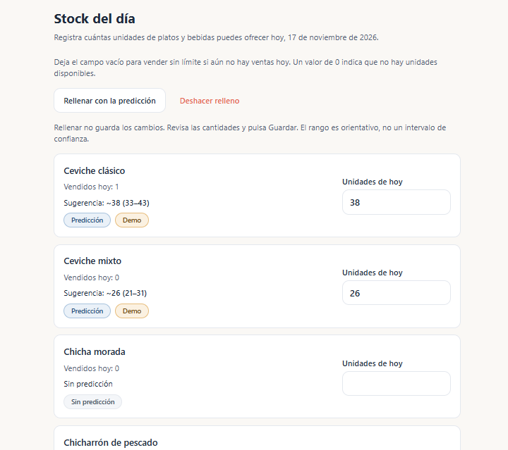
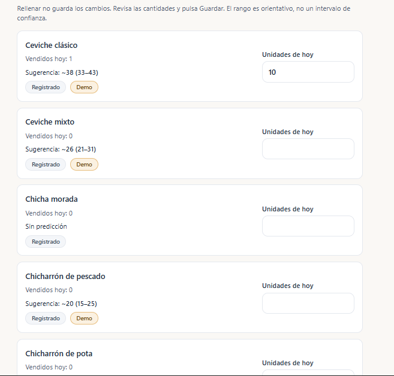

# US-104: rellenar el stock con la predicción

Fecha de validación: 17/11/2026.
Rama: dev/fabrizio.

## Implementación

- Consulta las predicciones de hoy en hora de Lima para el restaurante autorizado.
- Muestra «Rellenar con la predicción» cuando existen sugerencias para productos activos.
- El relleno modifica los campos del formulario sin guardar automáticamente.
- Muestra la cantidad sugerida, su rango orientativo y el origen del valor.
- La edición manual cambia la marca a «Editado por ti».
- «Deshacer relleno» recupera los valores anteriores al último relleno.
- Los productos sin predicción quedan vacíos al rellenar si no tienen ventas.
- Si un producto sin predicción ya tiene ventas, conserva su stock para respetar las reglas existentes.
- El guardado reutiliza guardarStockAction y la RPC guardar_stock_diario, con autorización OWNER/ADMIN.
- Un formulario de una fecha anterior se rechaza al guardar.

## Predicciones regeneradas

Se reutilizó el modelo XGBoost de US-087, conservando su entrenamiento
y cambiando el periodo de predicción al 16–20/11/2026.

Resultado: 25 filas, correspondientes a cinco platos durante cinco días.
El escenario utiliza feriado=0 y hay_evento=0.

Las bebidas sin predicción permanecen identificadas como «Sin predicción».

El rango mostrado es orientativo: cantidad prevista ±5 unidades,
limitado a valores válidos. El margen corresponde al MAE documentado
de US-087, 4.26, redondeado hacia arriba. No es un intervalo de confianza.

## Simulacro de carga

Comando ejecutado:

```powershell
node --env-file=.env.local scripts/analitica/cargar-predicciones.mjs --restaurante 10000000-0000-0000-0000-000000000001
```

Resultado:

```text
Modo: SIMULACRO (sin escrituras)
CSV: 25 filas. Coinciden: 25. Omitidas: 0.
No se escribió ninguna predicción.
```

La carga del CSV regenerado en la base compartida corresponde a Alexander.
El simulacro no demuestra que esa carga se haya realizado.

## Pruebas automáticas

- npm run lint: sin errores.
- npm run typecheck: sin errores.
- npm test: 84 archivos y 1393 pruebas aprobadas.
- npm run build: compilación correcta.
- git diff --check: sin errores de espacios; avisos LF/CRLF.

tests/unit/rellenar-stock.test.ts contiene 27 pruebas de la lógica
de relleno, ausencia de predicción, redondeo, edición y deshacer.

tests/unit/cargar-predicciones.test.ts contiene 38 pruebas, incluida
la validación del CSV regenerado y del desplazamiento de fechas.

## Evidencia visual





La etiqueta «Demo», cuando aparece, identifica predicciones cuyo modelo
termina en -demo; no acredita la carga del CSV regenerado.
